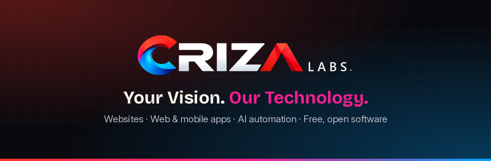
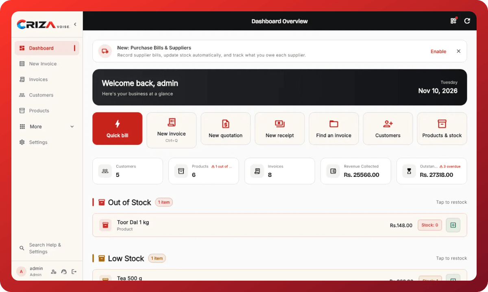
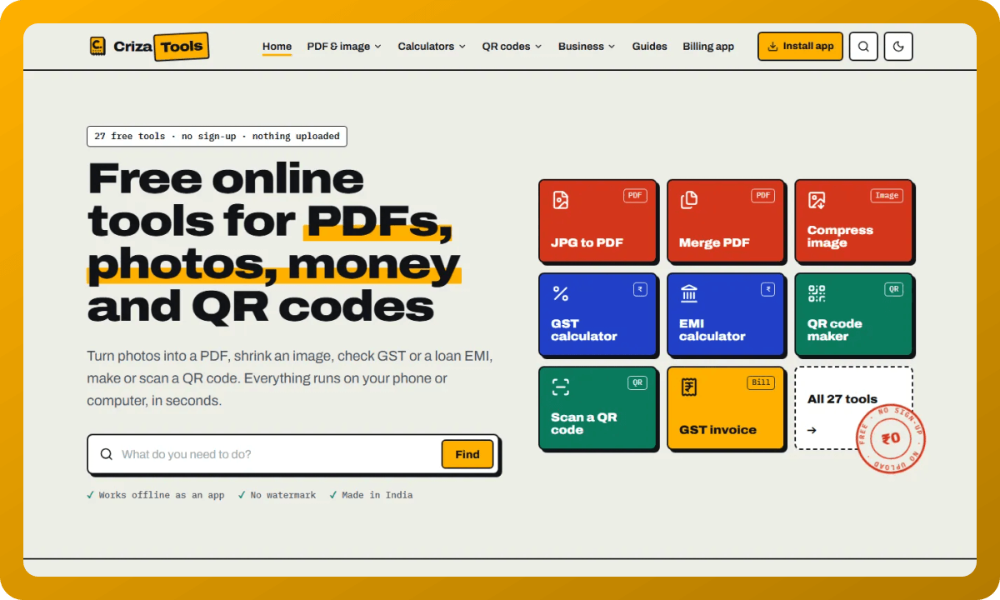

 
 

 
 

**Criza Labs is a founder-led software and AI development team building websites, mobile apps and AI automation for growing businesses worldwide.**

The people who plan your project are the people who write the code.

 

## What we build

<table>
  <tr>
    <td width="33%" valign="top">
      <h3>🌐 Websites</h3>
      Fast, search-ready business websites and landing pages, built to load quickly on mobile data and to be found on Google and in AI answers.
    </td>
    <td width="33%" valign="top">
      <h3>📱 Web &amp; mobile apps</h3>
      Dashboards, portals, SaaS products and cross-platform apps, from the first screen to deployment and support.
    </td>
    <td width="33%" valign="top">
      <h3>🤖 AI automation</h3>
      Assistants, document workflows and integrations that take repetitive work off your team's plate.
    </td>
  </tr>
</table>

 

## Our products

We release free software to show how we work.

<table>
  <tr>
    <td width="50%" valign="top">
      

        
        <b>&nbsp;CrizaVoise</b> 
        &nbsp;Free, open-source billing software
      

      
      
GST invoices, quotations, thermal receipts, stock and payments for small businesses. It works fully offline on Windows, Linux and macOS, and your data stays on your computer.

      

        
        
        
      

      <b><a href="https://voise.criza.dev">Download free →</a></b> &nbsp;·&nbsp; <a href="https://github.com/CRIZA-LABS/crizavoise">Source code</a>
    </td>
    <td width="50%" valign="top">
      

        
        <b>&nbsp;CrizaTools</b> 
        &nbsp;27 free tools that run in your browser
      

      
      
JPG to PDF, merge PDF, an image compressor, GST, EMI and SIP calculators, QR codes and a GST invoice generator. No sign-up, nothing uploaded, and it installs as an app that works offline.

      

        
        
        
      

      <b><a href="https://criza.web.id">Open CrizaTools →</a></b>
    </td>
  </tr>
</table>

 

## How we work

| | |
| --- | --- |
| **Founder-led** | You talk to the engineers who build your product, from the first call to launch. |
| **Built to last** | Clean, documented code that you own, with tests where they matter. |
| **Fast by default** | Light pages, small bundles and edge hosting, so things open quickly on any connection. |
| **Privacy first** | We process data on the device whenever we can and collect only what a feature needs. |

 

## Tech we use

  

 

## The team

<table>
  <tr>
    <td align="center" width="50%">
       
      <b>AbrarAli S.</b> 
      Co-founder · Full-stack &amp; AI engineer 
      <a href="https://github.com/AbraraliS">@AbraraliS</a>
    </td>
    <td align="center" width="50%">
       
      <b>AkbarAli N.</b> 
      Co-founder · Backend engineer 
      <a href="https://github.com/Akbarali-Nagalpara">@Akbarali-Nagalpara</a>
    </td>
  </tr>
</table>

 

## Planning a website, an app or an automation?

Tell us what you need and we'll reply with a clear plan.

 
 

<b>Criza Labs</b> · Your Vision. Our Technology. · Made in India

