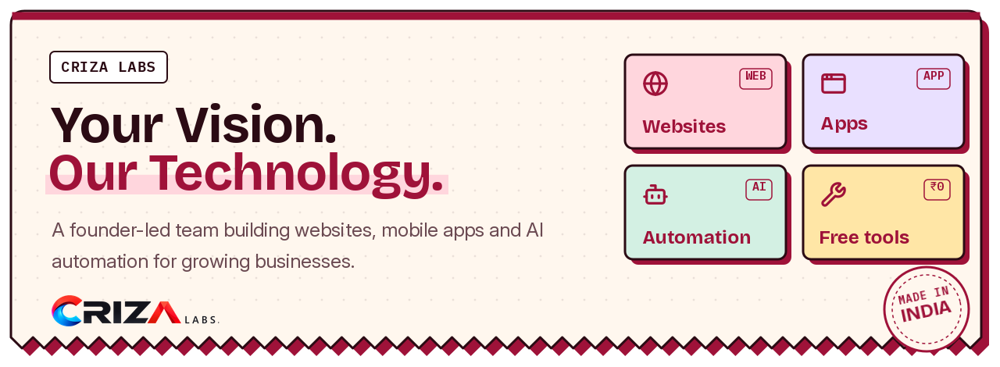
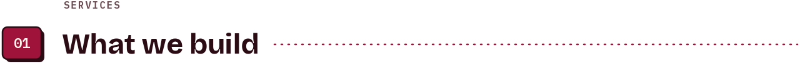
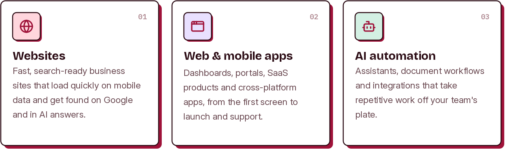
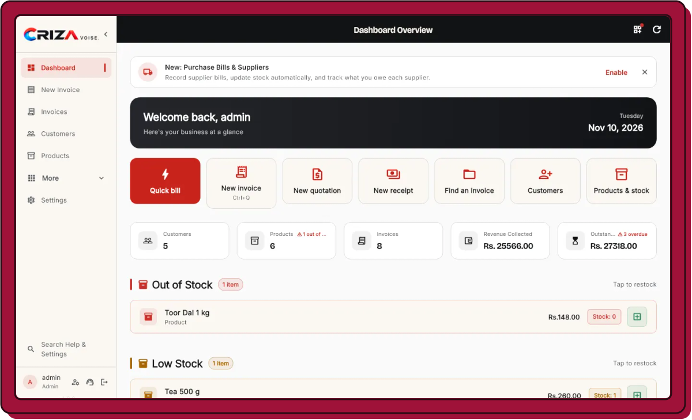
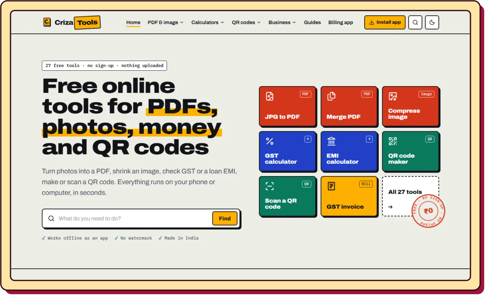
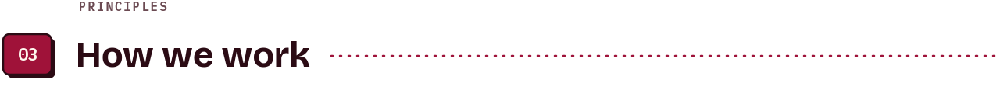
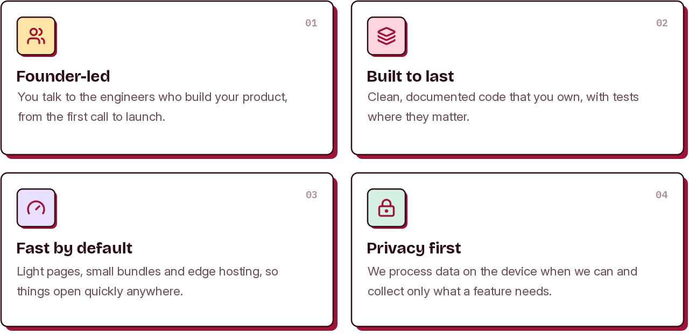
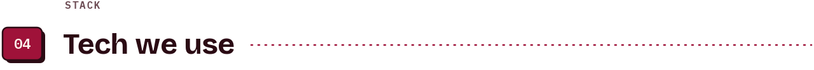
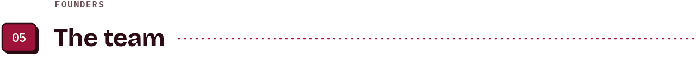
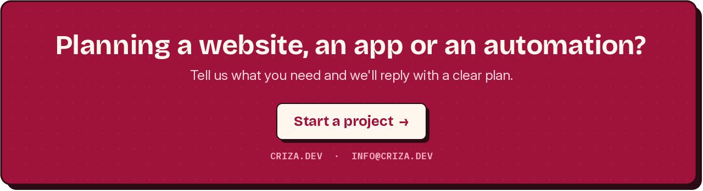

<a href="https://criza.dev"><picture>
  <source media="(prefers-color-scheme: dark)" srcset="https://raw.githubusercontent.com/CRIZA-LABS/.github/main/profile/assets/banner-dark.png" />
  
</picture></a>

 
 

 
 

<h3>Criza Labs is a founder-led software and AI development team building websites, mobile apps and AI automation for growing businesses worldwide.</h3>

The people who plan your project are the people who write the code.

 

<picture>
  <source media="(prefers-color-scheme: dark)" srcset="https://raw.githubusercontent.com/CRIZA-LABS/.github/main/profile/assets/h-what-dark.png" />
  
</picture>

 

<picture>
  <source media="(prefers-color-scheme: dark)" srcset="https://raw.githubusercontent.com/CRIZA-LABS/.github/main/profile/assets/services-dark.png" />
  
</picture>

 
 

<picture>
  <source media="(prefers-color-scheme: dark)" srcset="https://raw.githubusercontent.com/CRIZA-LABS/.github/main/profile/assets/h-products-dark.png" />
  
</picture>

We release free software to show how we work.

<table>
  <tr>
    <td width="50%" valign="top">
      <a href="https://voise.criza.dev"><picture>
  <source media="(prefers-color-scheme: dark)" srcset="https://raw.githubusercontent.com/CRIZA-LABS/.github/main/profile/assets/crizavoise-dark.png" />
  
</picture></a>
      <h3>&nbsp; CrizaVoise</h3>
      <b>FREE, OPEN-SOURCE BILLING SOFTWARE</b>
      
GST invoices, quotations, thermal receipts, stock and payments for small businesses. It works fully offline on Windows, Linux and macOS, and the data stays on the user's computer.

      
  

      
<a href="https://voise.criza.dev"><b>Download free</b></a> &nbsp;&middot;&nbsp; <a href="https://github.com/CRIZA-LABS/crizavoise">Source code</a>

    </td>
    <td width="50%" valign="top">
      <a href="https://criza.web.id"><picture>
  <source media="(prefers-color-scheme: dark)" srcset="https://raw.githubusercontent.com/CRIZA-LABS/.github/main/profile/assets/crizatools-dark.png" />
  
</picture></a>
      <h3>&nbsp; CrizaTools</h3>
      <b>27 FREE TOOLS THAT RUN IN YOUR BROWSER</b>
      
JPG to PDF, merge PDF, an image compressor, GST, EMI and SIP calculators, QR codes and a GST invoice generator. No sign-up, nothing uploaded, and it installs as an app that works offline.

      
  

      
<a href="https://criza.web.id"><b>Open CrizaTools</b></a>

    </td>
  </tr>
</table>

 

<picture>
  <source media="(prefers-color-scheme: dark)" srcset="https://raw.githubusercontent.com/CRIZA-LABS/.github/main/profile/assets/h-how-dark.png" />
  
</picture>

 

<picture>
  <source media="(prefers-color-scheme: dark)" srcset="https://raw.githubusercontent.com/CRIZA-LABS/.github/main/profile/assets/principles-dark.png" />
  
</picture>

 
 

<picture>
  <source media="(prefers-color-scheme: dark)" srcset="https://raw.githubusercontent.com/CRIZA-LABS/.github/main/profile/assets/h-stack-dark.png" />
  
</picture>

 

  
   
  

 
 

<picture>
  <source media="(prefers-color-scheme: dark)" srcset="https://raw.githubusercontent.com/CRIZA-LABS/.github/main/profile/assets/h-team-dark.png" />
  
</picture>

 

<table align="center">
  <tr>
    <td align="center" width="300">
       
      
      <h3>AbrarAli S.</h3>
      CO-FOUNDER &middot; FULL-STACK &amp; AI ENGINEER
        
      
        
    </td>
    <td align="center" width="300">
       
      
      <h3>AkbarAli N.</h3>
      CO-FOUNDER &middot; BACKEND ENGINEER
        
      
        
    </td>
  </tr>
</table>

 

<a href="https://criza.dev"><picture>
  <source media="(prefers-color-scheme: dark)" srcset="https://raw.githubusercontent.com/CRIZA-LABS/.github/main/profile/assets/cta-dark.png" />
  
</picture></a>

   
  <b>CRIZA LABS</b> &nbsp;&middot;&nbsp; Your Vision. Our Technology. &nbsp;&middot;&nbsp; Made in India

